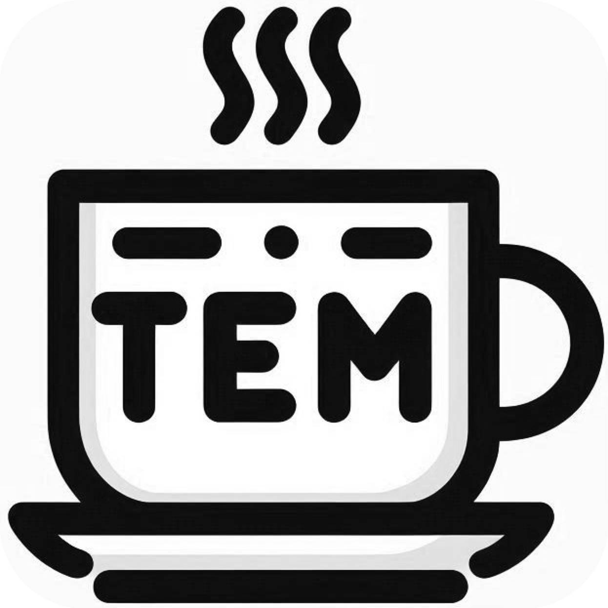

# Welcome to TemCompanion

TemCompanion is an open-source, light-weight, and multi-platform GUI program for TEM image processing and analysis. TemCompanion supports various file formats for major TEM brands, such as Thermo Fisher Scientific Velox emd, Gatan dm3/dm4, EMPAD raw/xml, NanoMegas ASTAR blo, general HDF5, as well as common image formats such as tiff, jpg, png, etc. TemCompanion provides interactive tools for essential image processing tasks such as cropping, rotating, measuring, filtering, Fourier transforming, rigid/non-rigid stack alignment, geometric phase analysis (GPA), and differential phase contrast (DPC) reconstruction. For 4D-STEM datasets, TemCompanion can visualize, calibrate, and transpose the datasets, as well as generating virtual images, DPC/iCOM, PACBED, etc. More functions will be implemented in the future releases.

[Open the User Guide](User%20Guide.md) for detailed descriptions of implemented functions.

TemCompanion is free for everyone. Visit the [GitHub](https://github.com/matao1984/temcompanion) page for the source code. Have questions or suggestions? Want to contribute? Drop me an email: [matao1984@gmail.com](mailto:matao1984@gmail.com)

If TemCompanion helped your TEM image analysis in a publication, please cite:

Tao Ma, TemCompanion: An open-source multi-platform GUI program for TEM image processing and analysis, SoftwareX, 2025, 31, 102212. [doi:10.1016/j.softx.2025.102212](https://doi.org/10.1016/j.softx.2025.102212)

Your support is important! [Buy me a coffee](https://paypal.me/matao1984?country.x=US&locale.x=en_US) if you like it!
